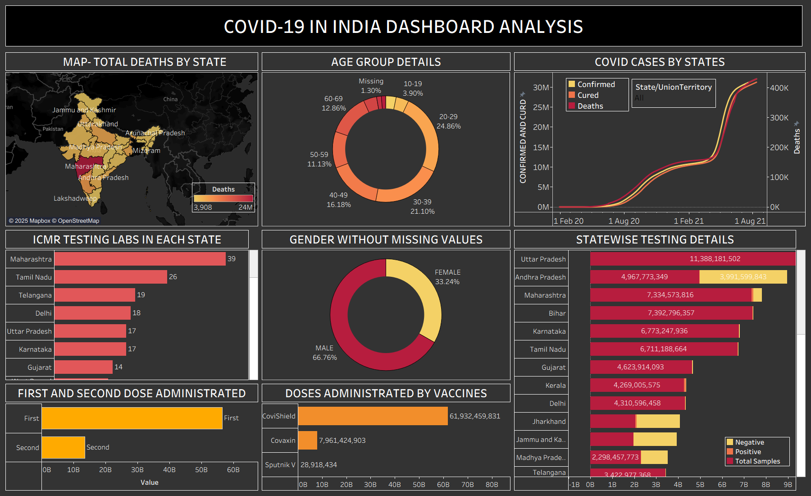

# COVID-19 India Tableau Dashboard 📊

An interactive Tableau dashboard exploring COVID-19 cases, deaths, testing, demographics, and vaccination trends across India.

## 📸 Dashboard Preview

## 📌 Project Overview

This project presents a visual analysis of historical COVID-19 data in India using Tableau. It combines epidemiological, demographic, testing, vaccination, and geographical data into a single dashboard to make trends and comparisons easier to explore.

## 📊 Key Visualizations

- **Total Deaths by State:** Geographical distribution of reported COVID-19 deaths across India.
- **Age Group Details:** Distribution of records across different age groups.
- **COVID Cases by States:** Historical trends in confirmed cases, recoveries, and deaths.
- **ICMR Testing Labs:** Comparison of testing laboratories across states.
- **Gender Distribution:** Male and female distribution excluding missing values.
- **Statewise Testing Details:** Visualization of reported positive, negative, and total sample measures.
- **First and Second Doses:** Comparison of recorded vaccination doses.
- **Doses by Vaccines:** Comparison of vaccination figures for Covishield, Covaxin, and Sputnik V.

## 🛠️ Tools & Technologies

- Tableau
- CSV Datasets
- Data Visualization
- Exploratory Data Analysis (EDA)

## 📂 Datasets

The project uses the following datasets:

- `covid_19_india.csv`
- `AgeGroupDetails.csv`
- `IndividualDetails.csv`
- `ICMRTestingLabs.csv`
- `StatewiseTestingDetails.csv`
- `covid_vaccine_statewise.csv`
- `India_State_Shapefile (1).zip`

## 🚀 How to Use

1. Clone or download this repository.
2. Open `dahsboard_covid_19.twb` in Tableau Desktop.
3. Reconnect the data sources if prompted.
4. Explore the dashboard and its visualizations.

**Note:** The `.twb` workbook may depend on the original data-source paths. A packaged `.twbx` workbook can be added for easier sharing.

## 💡 Key Highlights

- Visual comparison of COVID-19 trends across time and geography.
- Demographic analysis of recorded cases.
- Exploration of testing infrastructure and statistics.
- Comparison of reported vaccination doses and vaccine categories.
- Multiple visualizations consolidated into one dashboard.

## ⚠️ Disclaimer

This project is intended for educational and analytical purposes. It represents historical data and does not provide real-time COVID-19 statistics or medical advice.
